# context-budgeter

**Fit a chat message history into a model's context window — a tiny, zero-dependency, tokenizer-agnostic trimmer with pluggable strategies (`keep-system`, `drop-oldest`, `middle-out`, `summarize`) and a hard guarantee it never exceeds the budget or drops a pinned message. For Node and the browser.**

<p>
  <a href="https://www.npmjs.com/package/context-budgeter"></a>
  <a href="https://github.com/H1manshu01/context-budgeter/actions/workflows/ci.yml"></a>
  <a href="https://bundlephobia.com/package/context-budgeter"></a>
  
  <a href="./LICENSE"></a>
</p>



Every LLM app eventually overflows the context window. The conversation grows, a few long tool results land in the middle, and the next request crosses the model's limit. The fix is always the same **shape** — keep the system prompt, keep the most recent turns, drop or fold the rest until it fits — and it gets re-implemented, badly, in every codebase. Get it wrong and you ship one of three failures: a hard **400** from the provider ("maximum context length exceeded"), a conversation that is **silently truncated** at the wrong place, or a request that **drops the system prompt** and quietly changes the model's behavior.

`context-budgeter` is that trimming shape, done once and correctly: you bring a token counter, it brings the strategies, and it guarantees the result is within budget with the messages you pinned still present — or it throws loudly rather than returning something over budget.

```ts
import { fit } from "context-budgeter";
import { estimate, limitFor } from "context-budgeter/models";

const { messages, dropped, tokens, fits } = fit(history, {
  count: estimate,                          // bring your own: a real tokenizer is more accurate
  budget: limitFor("gpt-4o") ?? 128_000,
  reserve: 1_000,                           // hold back for the reply
  strategy: ["keep-system", "middle-out"],  // try in order until it fits
  keep: { last: 4 },                        // always keep the 4 most recent
});

// `messages` is within `budget - reserve`, in original order, system still first.
// `dropped` is what was removed. `fits` is whether it all fit.
```

## Why another one?

Trimming a chat history is simple until it isn't. The **LLM** case specifically needs: a token counter you choose (there is no one true tokenizer — OpenAI, Anthropic, and Llama all count differently, and an exact count often means a real BPE tokenizer or a provider's token-count API), strategies beyond "chop the front" (keep the system prompt; drop from the *middle* so you retain both the oldest framing and the newest turns; or fold the dropped span into a summary), the ability to **pin** messages that must never be dropped (a system prompt, a few-shot example, the current user turn), and an invariant that matters when the budget is tight — tool-call and tool-result messages must drop **together**, because a provider rejects a tool result with no preceding call. Most ad-hoc trimmers and framework helpers cover some of that; the gaps are exactly where a long agent conversation breaks.

| | context-budgeter | `tokenlens` | LangChain `trimMessages` | `ctx-compact` | `slimcontext` |
|---|:---:|:---:|:---:|:---:|:---:|
| Trims a history to fit a token budget | Yes | — (counts only) | Yes | Yes | Yes |
| Tokenizer-agnostic, bring-your-own counter | Yes | n/a (it *is* a counter) | Needs a model/encoder | Varies | Varies |
| Strategies: `drop-oldest` / `middle-out` | Yes | — | first / last | Varies | — |
| `summarize` (fold dropped into a summary) | Yes (hook) | — | — | — | Yes (LLM) |
| Pinning: system / first / last / custom predicate | Yes | — | `includeSystem` only | Varies | Varies |
| Tool-call + tool-result drop together | Yes | — | Partial | Varies | Varies |
| Never exceeds budget / never drops a pin | Yes (throws otherwise) | n/a | Best-effort | Varies | Varies |
| Zero runtime dependencies | Yes | Small | — (LangChain) | Varies | Varies |

Comparison claims about third-party libraries are **as of early 2026** — re-check each project before quoting it. `gpt-tokenizer` and `js-tiktoken` are **counters you pair with** `context-budgeter` (pass one as `count`), not competitors. See [COMPETITORS.md](./COMPETITORS.md) for the full scan with specifics.

## Install

```sh
npm install context-budgeter
```

Zero runtime dependencies. Ships ESM + CJS + `.d.ts`; the core is ~971 B and the optional models module ~298 B min+brotli. Runs anywhere modern JavaScript does: **Node ≥ 18** and modern **browsers**. No tokenizer is bundled — you bring the counter (see [Bring your own counter](#bring-your-own-counter)).

`context-budgeter` is part of the author's LLM dev-tools line — siblings:
[`sse-wire`](https://www.npmjs.com/package/sse-wire) (fetch-based SSE),
[`trickle-json`](https://www.npmjs.com/package/trickle-json) (streaming partial-JSON parse),
[`coerce-json`](https://www.npmjs.com/package/coerce-json) (schema repair/coercion),
[`trickle-react`](https://www.npmjs.com/package/trickle-react) (React bindings),
[`expect-llm`](https://www.npmjs.com/package/expect-llm) (LLM output assertions), and
[`retry-wire`](https://www.npmjs.com/package/retry-wire) (provider-aware retry/throttle).
Each is zero-dependency and useful on its own.

## Quick start

`fit` is synchronous and deterministic. You give it the messages and two required options — a `count` function and a `budget` — and it returns what fits.

```ts
import { fit } from "context-budgeter";

type Message = { role: "system" | "user" | "assistant" | "tool"; content: string };

const history: Message[] = [
  { role: "system", content: "You are a terse assistant." },
  { role: "user", content: "What is the capital of France?" },
  { role: "assistant", content: "Paris." },
  { role: "user", content: "And of Japan?" },
];

const result = fit(history, {
  count: (text) => Math.ceil(text.length / 4), // a rough BYO counter; see below
  budget: 20,                                  // in whatever unit `count` returns
  reserve: 4,                                  // held back for the reply
});

result.messages; // the messages that fit, in original order (system kept, last kept)
result.dropped;  // the messages that were removed
result.tokens;   // total tokens of result.messages
result.budget;   // the effective budget (20 - 4 = 16)
result.fits;     // true if result.messages is within result.budget
```

Nothing is mutated — `history` is untouched, and every message in the result is the same object you passed in, with all its extra fields intact.

## API

Two entry points. The core (`context-budgeter`) is the trimmer and its types; the optional `context-budgeter/models` is a rough estimator and a model-limit table, kept separate so the core stays tiny and tokenizer-agnostic.

```ts
import { fit, fitAsync } from "context-budgeter";
import type {
  Message,
  Role,
  CountFn,
  Strategy,
  KeepRule,
  FitOptions,
  FitResult,
} from "context-budgeter";

// optional batteries
import { estimate, MODELS, limitFor } from "context-budgeter/models";
import type { ModelId } from "context-budgeter/models";
```

### `fit(messages, options) → FitResult`

Fit `messages` into the budget **synchronously**. Applies the strategy (or the strategy list, in order) until the kept messages are within `budget - reserve`, then returns them in their original order alongside what was dropped.

```ts
const r = fit(history, { count, budget: 8_000, reserve: 500 });
if (!r.fits) {
  // Only possible when even the pinned set plus nothing else is still over —
  // which instead throws a RangeError (see Guardrails). In normal use r.fits is true.
}
```

- Throws a `TypeError` if `options.count` is not a function, or `options.budget` is not a finite number.
- Throws a `RangeError` if the **pinned set alone** exceeds the effective budget — it never silently returns something over budget.
- Throws an `Error` if you pass a `summarize` hook with the `"summarize"` strategy and it would need to run — summarizing is async, so use [`fitAsync`](#fitasyncmessages-options--promisefitresult) for that.

### `fitAsync(messages, options) → Promise<FitResult>`

Like `fit`, but `await`s an optional [`summarize`](#summarizing) hook that folds the dropped messages into a single summary message, inserted where the dropped span used to be. Use it whenever `options.summarize` is set; otherwise it behaves exactly like `fit`.

```ts
const r = await fitAsync(history, {
  count,
  budget: 8_000,
  strategy: ["drop-oldest", "summarize"],
  summarize: async (dropped) => ({
    role: "system",
    content: await summarizeWithAnLLM(dropped),
  }),
});
```

### `FitResult`

```ts
interface FitResult {
  messages: Message[]; // what fits, in original order (plus a summary if summarized)
  dropped: Message[];  // what was removed (or folded into the summary)
  tokens: number;      // token count of `messages`
  budget: number;      // the effective budget (budget - reserve)
  fits: boolean;       // whether `messages` is within `budget`
}
```

`messages` and `dropped` together partition the input (plus the summary message, if one was produced). Message order and every passthrough field are preserved; the input array and its messages are never mutated.

## Options

```ts
interface FitOptions {
  count: CountFn;                          // required
  budget: number;                          // required
  reserve?: number;
  strategy?: Strategy | Strategy[];
  keep?: KeepRule;
  summarize?: (dropped: Message[]) => Message | Promise<Message>;
}
```

| Option | Type | Default | What it does |
|---|---|---|---|
| `count` | `(text: string, message?: Message) => number` | — (**required**) | Your token counter. Called once per message with its `content` (and the whole message, for counters that weigh roles or fields). No tokenizer is bundled — see [Bring your own counter](#bring-your-own-counter). |
| `budget` | `number` | — (**required**) | The token budget, in whatever unit `count` returns. Derive it from `limitFor(model)` if you like. |
| `reserve` | `number` | `0` | Tokens held back for the model's reply. The **effective budget** the result must fit is `budget - reserve`, and that is what `FitResult.budget` reports. |
| `strategy` | `Strategy \| Strategy[]` | `"drop-oldest"` | One strategy, or several applied **in order** until the history fits. See [Strategies](#strategies). |
| `keep` | `KeepRule` | `{ system: true, last: 1 }` | Which messages are pinned (never dropped). See [Pinning and tool-call adjacency](#pinning-and-tool-call-adjacency). |
| `summarize` | `(dropped) => Message \| Promise<Message>` | — | Folds the dropped messages into one summary message. Requires the `"summarize"` strategy **and** `fitAsync`. See [Summarizing](#summarizing). |

### Strategies

A `Strategy` decides the **order in which droppable messages are removed**. Pass one, or an array that is tried in sequence — each strategy runs only if the history still does not fit after the previous one.

| Strategy | What it does |
|---|---|
| `"drop-oldest"` (default) | Drops droppable messages from the **front** (oldest first), keeping the newest. The classic sliding window. |
| `"keep-system"` | Forces every `system` message to be pinned for this run, even if `keep.system` is `false`. Pair it first in a list, e.g. `["keep-system", "drop-oldest"]`, to guarantee the system prompt survives whatever follows. |
| `"middle-out"` | Drops from the **center** of the droppable range outward, so the **oldest** framing and the **newest** turns are both retained and the middle of the conversation is sacrificed. |
| `"summarize"` | Marks the dropped messages to be folded into a summary by your `summarize` hook. Only has an effect via `fitAsync` with a `summarize` function set; on its own it behaves like a drop. |

Strategies are applied until the budget is met, so a list like `["keep-system", "middle-out", "summarize"]` reads as: always keep system, prefer to drop the middle, and if it still doesn't fit, summarize what was dropped.

### `KeepRule`

```ts
interface KeepRule {
  system?: boolean;                                   // default true
  first?: number;                                     // pin the first N
  last?: number;                                      // default 1
  pin?: (message: Message, index: number) => boolean; // pin by predicate
}
```

See [Pinning and tool-call adjacency](#pinning-and-tool-call-adjacency) for how these combine.

## Bring your own counter

`context-budgeter` bundles **no tokenizer** — every provider counts tokens differently, real BPE tokenizers are large, and a token-count API is sometimes the only exact source. So you pass a `count` function and own the accuracy/size trade-off:

```ts
type CountFn = (text: string, message?: Message) => number;
```

It is called once per message with that message's `content`, plus the whole `message` (so a counter can add a fixed per-message overhead, weigh the `role`, or account for `name` / `tool_calls` fields). Return the token count as a number.

A real tokenizer is the accurate choice. Pair with one of the usual counters — they are complements, not competitors:

```ts
// Exact, with a real BPE tokenizer (pick the encoding for your model):
import { encode } from "gpt-tokenizer";
const count: CountFn = (text) => encode(text).length;
```

```ts
// Or a provider's token-count endpoint, wrapped as a CountFn you pre-measure with.
```

### Optional: `context-budgeter/models`

For a quick start without wiring up a tokenizer, the optional module ships a rough estimator and a small model-limit table. **Both are approximations** and deliberately kept out of the core:

```ts
import { estimate, MODELS, limitFor } from "context-budgeter/models";

estimate("hello world");            // ~3 — a rough ceil(chars / 4) heuristic
limitFor("gpt-4o");                 // 128000
limitFor("gpt-4o-2024-08-06");      // 128000 — version prefixes resolve to the base id
limitFor("claude-3-5-sonnet-xyz");  // 200000
limitFor("totally-made-up");        // undefined

MODELS["gpt-4"];                    // 8192 — the raw table, if you want to read or extend it
```

- `estimate: CountFn` — about **4 characters per token**. Good enough to prototype; it will disagree with a real tokenizer, sometimes meaningfully, so do not rely on it for a tight budget near the limit.
- `MODELS: Record<string, number>` — a **hand-maintained** table of context-window sizes. It can lag new or renamed models.
- `limitFor(model): number | undefined` — an exact id match first, then a **version-prefix** match (so `"gpt-4o-2024-08-06"` resolves via `"gpt-4o"`), and `undefined` for an unknown model. That is why the quick start writes `limitFor("gpt-4o") ?? 128_000` — always have a fallback.

Treat the models module as a convenience for getting started; graduate to a real tokenizer and your own authoritative limits for production budgets.

## Pinning and tool-call adjacency

A **pinned** message is never dropped, by any strategy. Pins come from `keep`, and they combine — a message is pinned if **any** rule matches:

```ts
fit(history, {
  count,
  budget,
  keep: {
    system: true,                              // keep every system message (default)
    first: 2,                                  // keep the first 2 (e.g. a few-shot pair)
    last: 4,                                   // keep the 4 most recent (default is 1)
    pin: (m, i) => m.name === "important",     // keep anything your predicate matches
  },
});
```

- `system` (default `true`) pins every `system`-role message.
- `first` pins the first N messages; `last` (default `1`) pins the last N.
- `pin(message, index)` pins any message for which it returns `true`.

**Tool-call adjacency.** A `tool` message (a tool result) is grouped with the message that precedes it, and the group drops as a unit. So an assistant message that issued a tool call and the `tool` result that answers it are **dropped together** — a tool result is never orphaned from its call, which would make a provider reject the request. Pinning or keeping the assistant call keeps its tool results too.

```ts
const history = [
  { role: "system", content: "..." },
  { role: "user", content: "weather in Paris?" },
  { role: "assistant", content: "", tool_calls: [{ id: "t1", /* ... */ }] },
  { role: "tool", content: '{"tempC":14}', tool_call_id: "t1" },
  { role: "user", content: "and tomorrow?" },
];
// If the assistant call is dropped, its tool result drops with it — never one without the other.
```

## Summarizing

Instead of discarding the dropped span, you can fold it into a single summary message. Because that usually means another LLM call, it is **async-only**: set the `"summarize"` strategy and a `summarize` hook, and call `fitAsync`.

```ts
const r = await fitAsync(history, {
  count,
  budget: 4_000,
  strategy: ["drop-oldest", "summarize"], // drop first; summarize what dropped
  summarize: async (dropped) => ({
    role: "system",
    content: await myLLM.summarize(dropped), // or any reducer you like
  }),
});
// r.messages contains the summary inserted where the dropped span used to be,
// r.dropped is the raw messages that were folded in.
```

The summary is inserted in place (where the first dropped message was), so conversational order reads naturally. Calling `fit` (not `fitAsync`) with a `summarize` hook that would run throws — a clear signal to switch to the async entry point. See the note in [Guardrails](#guardrails) about the summary's own token cost.

## Guardrails

A trimmer is only useful if you can trust the result it returns. `context-budgeter` holds these invariants, covered by 15 tests (`test/`):

- **The result never exceeds the budget.** `fit` drops (or folds) until the kept messages are within `budget - reserve`. There is no mode that returns something over budget as "close enough."
- **Pinned messages are never dropped.** System (by default), the first/last N, and anything your `pin` predicate matches are untouchable by every strategy.
- **An impossible budget throws, loudly.** If the pinned set **alone** exceeds the effective budget, `fit` throws a `RangeError` rather than silently returning an over-budget result — you find out at the call site, not at the provider.
- **Order and passthrough fields are preserved, and the input is never mutated.** Messages come back in their original order, every extra field (`name`, `tool_calls`, `tool_call_id`, anything) is carried through untouched, and the array you passed in is left exactly as it was. A property test asserts this across hundreds of random inputs.
- **Tool-call and tool-result messages drop together.** A `tool` result is never separated from the call it answers.
- **Deterministic and synchronous by default.** Given the same inputs, `fit` returns the same result with no I/O and no randomness. The only async path is a `summarize` hook, which `fit` refuses (throwing) so you reach for `fitAsync` deliberately.
- **Strategy ordering is explicit.** `middle-out` drops from the center of the droppable range outward (keeping the oldest and newest); `drop-oldest` drops from the front. You choose, and a strategy list is tried in order until the history fits.

> One honest edge: when you `summarize`, the summary message has its own token cost, which is added after the drop pass. If your summary is unusually large it can push the total slightly over budget — `FitResult.fits` will report `false` in that case, so check it. Keep summaries short, or reserve headroom for them.

## Types

```ts
type Role = "system" | "user" | "assistant" | "tool";

interface Message {
  role: Role;
  content: string;
  [extra: string]: unknown; // e.g. name, tool_calls, tool_call_id — preserved untouched
}

type CountFn = (text: string, message?: Message) => number;

type Strategy = "keep-system" | "drop-oldest" | "middle-out" | "summarize";

interface KeepRule {
  system?: boolean;                                   // default true
  first?: number;
  last?: number;                                      // default 1
  pin?: (message: Message, index: number) => boolean;
}

interface FitOptions {
  count: CountFn;                          // required
  budget: number;                          // required
  reserve?: number;
  strategy?: Strategy | Strategy[];        // default "drop-oldest"
  keep?: KeepRule;
  summarize?: (dropped: Message[]) => Message | Promise<Message>;
}

interface FitResult {
  messages: Message[];
  dropped: Message[];
  tokens: number;
  budget: number;  // the effective budget (budget - reserve)
  fits: boolean;
}

// from context-budgeter/models
type ModelId = string;
```

## Development

```sh
npm install
npm test          # vitest (15 unit + property tests via fast-check)
npm run typecheck
npm run build     # tsup -> ESM + CJS + .d.ts
npm run size      # size-limit
npm run lint      # Biome
npm run smoke     # cross-runtime smoke test against built dist/
```

## License

MIT (c) Himanshu Sharma
